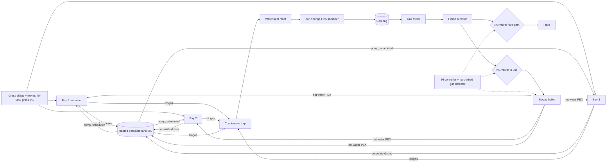

# SPEC: DIY batch leach-bed digester for grass + leaves

Legend: **[S]** sourced (link), **[E]** estimate/assumption to verify.

## 1. Process choice
Batch "garage/tunnel" dry digestion with percolate (leachate) recirculation, in three insulated, lined
20 ft containers plus a heated percolate tank. Why:
- Stackable yard waste at 25-40% solids can't be pumped; leach beds handle it without mixers or shredding to slurry.
- Commercial garage digesters (BEKON/SmartFerm) use this concept for green waste (see plan/PLAN.md).
- Pilot evidence: a 100 L dry reactor + 200 L percolate tank, recirculated twice daily, ran 60-day batches; most methane formed in the percolate tank [S] http://dergipark.gov.tr/ejens/issue/27741/292861
- Recirculation rate matters: daily recirculated volume = 0.3 x percolate volume gave the best yield (166 mL CH4/g VS, 67% of BMP); higher rates accumulated VFA [S] https://doi.org/10.1021/acs.energyfuels.7b01869
- Farm leach beds: trickling and flood-and-drain gave similar results (~50% of BMP); trickling easier to run; seeding with old digestate (ISR 0.22 VS) sped start-up [S] https://doi.org/10.1016/j.wasman.2016.02.031
- Rejected: wet CSTR (needs dilution/mixing of fibrous grass), single IBC totes (40+ totes for 4 t/week; fine only as a pilot).

A **pilot rig** (4 open-top 55 gal drums + 1 IBC percolate tank) is recommended first to measure your own feed.

## 2. Diagram

## 3. Sizing (run `python -m digester.sizing`; all inputs editable)
| Input | Value | Status |
|---|---|---|
| Feed | 4 wet t/week | [E] target, range 1-5 |
| Total solids | 35% | [E] test it |
| VS/TS | 85% | [E] |
| Blend methane potential | 180 m3 CH4/t VS (plan: 175-190) | [E] lab-style upper figure |
| Batch conversion | 55% of BMP | [S] range 50-67% in studies above |
| Loaded density / depth | 0.45 t/m3, 1.5 m | [E] |
| Cycle | 42 d (35 d digestion + handling) | [E] |

Results [E]: 1.19 t VS/week; ~118 m3 CH4/week (~17 m3/day, ~7 kW average thermal); bay = 20.8 m3,
~9.4 t per load; 2.56 bays needed -> **build 3**; average OLR ~3.2 kg VS/m3/day.
Percolate tank: 1-2 IBCs (~1-2 m3) per container system [E]; recirculate ~0.3 of percolate volume per day [S above].

## 4. Heating & insulation (Spokane winters)
Heat loss check [E]: container shell ~67 m2; 2x 2 in polyiso (R-26, U~0.22 W/m2K) -> at 35 C inside / -10 C outside,
~0.7 kW per bay, ~2-3 kW for 3 bays + tank, below the ~7 kW average gas energy, so self-heating is plausible
after start-up. Start-up needs outside heat (electric or propane). PEX loops on floor/walls fed by a
biogas boiler; heat percolate tank too (it does most methanogenesis). Insulate under floors; keep gas lines
sloped to traps and heat-trace them so condensate can't freeze.

## 5. Gas handling
Condensate trap at every low point -> water-seal pressure relief (set below bag/liner rating) ->
iron sponge scrubber (replace when outlet H2S rises) -> PVC gas bag (10 m3 ~ 14 h of production [E]) ->
diaphragm meter -> flame arrestor -> NC solenoid to boiler / NO solenoid to flare. On power loss or trip,
the NO valve opens and gas goes to flare. Operating pressure: a few inches of water column [E].

## 6. Digestate
At end of cycle: stop recirculation to that bay, vent bay to flare, purge with air fan and confirm
CH4 < 10% LEL and H2S < 1 ppm before entry, unload with loader, compost the solids (aerobic finish) and
store excess percolate as liquid fertilizer per a nutrient plan. Keep 10-20% of digestate as inoculum.

## 7. Controller summary
PID heating 36.5 C (coldest sensor), staggered recirculation (one pump at a time, level and pH guarded),
alarms (pH, CH4 quality, temp, H2S, pressure, level), latched interlocks (room CH4 >= 20% LEL, H2S >= 10 ppm,
over/under-pressure, over-temp, any sensor fault or stale data, hard-wired detector) -> all outputs off,
flare path open. CSV log + local dashboard.
